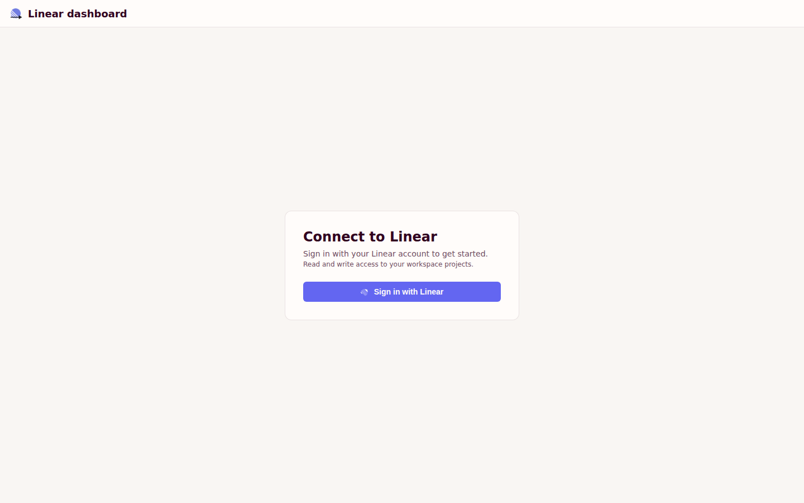
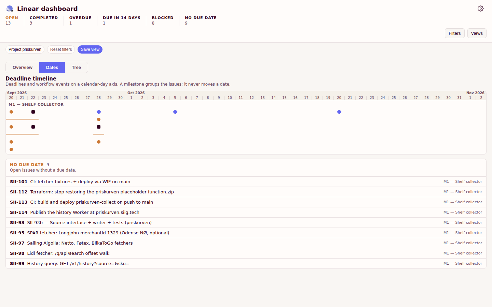
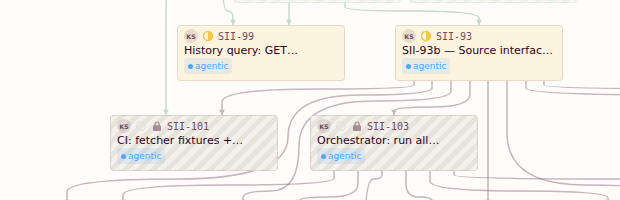
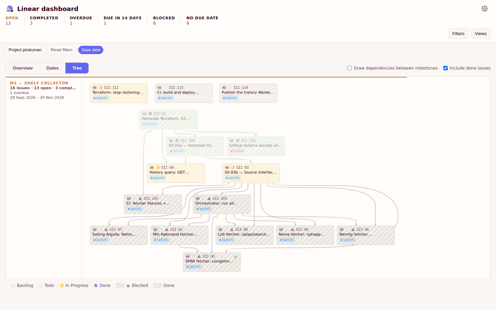

# Linear dashboard

A read-mostly dashboard over the issues of your Linear projects. It reads the facts Linear already holds — status, due date, milestone, assignee, priority, and blocking relations — and shows them in three views. It does not plan work.

## The three views

Every number and every date on the screen is a fact that Linear reports:

- **Overview** — the issues grouped by their due date: Overdue, Next, Soon, No date, Later.
- **Dates** — the deadline timeline: every issue on its due date, plus the open issues that have no due date.
- **Tree** — the dependency tree of the issues: which issue blocks which.

The bar above the views counts the issues that are loaded: open, completed, overdue, due in the next 14 days, blocked, and without a due date.

## What the dashboard does not do

The dashboard does **not** calculate estimates, workdays, capacity, inferred start dates, or a theoretical completion date. There is no duration, no worker count, and no verdict about a schedule anywhere in the app. It never moves a date and never predicts one: a date is the due date Linear reports, and a count is the number of issues that carry that fact.

## Opening an issue

| Gesture | What it does |
| -- | -- |
| Plain click on an issue | Opens the quick-look: the status, priority, assignee, due date, and relations of the issue. |
| Ctrl-click, or Cmd-click on macOS | Opens the issue in Linear in a new tab. The browser keeps its own behaviour. |
| Long press on a phone | Opens the issue in Linear in a new tab. |

The quick-look edits the issue. The status dropdown changes the status of the issue in Linear, and the quick-look also offers the priority, the assignee, and the due date. Editing is on by default: the app asks Linear for the `read,write` scope.

## Access and data

- The app signs in with Linear over OAuth (PKCE) and asks for the `read,write` scope.
- The token and the display preferences stay in the local storage of the browser.
- The issues, milestones, workflow states, and relations all come from Linear. The saved views are stored by the deployment, in a Cloudflare D1 database behind `/api/views`.
- The app keeps no copy of your issues.

## Screenshots

Landing page:



Dates view:



Blocked issue in the dependency tree:



Dependency tree view:



## Local setup

```bash
npm ci
VITE_LINEAR_CLIENT_ID=<your linear client id> npm run dev
```

`VITE_LINEAR_CLIENT_ID` is the client id of your Linear OAuth application. The sign-in returns to `<origin>/callback` on the same origin as the app.

## Commands

| Command | What it does |
| -- | -- |
| `npm run dev` | Starts the dev server on Vite. |
| `npm test` | Runs the Vitest suite once. |
| `npm run test:watch` | Runs the Vitest suite in watch mode. |
| `npm run lint` | Runs ESLint. |
| `npm run build` | Type-checks the project (`tsc -b`) and builds the production bundle. |
| `npm run preview` | Serves the production build. |
| `npm run visual` | Builds the app and captures the screenshot matrix with a headless browser. |
| `npm run visual:diff` | Captures the matrix again and diffs it against `screenshots/visual/baseline/`. |
| `npm run visual:update-baseline` | Captures the matrix and overwrites `screenshots/visual/baseline/`. |

The visual harness drives the Google Chrome binary on the machine, so Playwright is installed without a browser download:

```bash
PLAYWRIGHT_SKIP_BROWSER_DOWNLOAD=1 npm ci
npm run visual
```

## Stack

Made with React + TypeScript + Vite. The production build is deployed to Cloudflare Pages; a Docker image serves the same build behind nginx.

I don't own or take responsibility for this code as it was 100% AI-written.
